# Kagu

A wireless 36-key split keyboard (3x5+3) on the Seeed XIAO nRF52840, running ZMK.

- `keymap.txt`: the keymap, the only file to edit for layout changes
- `keymap/`: the generator that turns it into ZMK, and the diagram
- `config/`: ZMK shields and the generated `kagu.keymap`
- `pcb/`: KiCad projects for both halves
- `case/`: OpenSCAD trays, top plates and Choc v2 keycap risers

## Layout



Colemak-DH, after [dubu36](https://github.com/denniskempin/dubu36). Shortcut modifiers sit on the
home row (pinky to index: Shift, Ctrl, Alt, Super, mirrored). Shift and the layers you use while
writing sit on the thumbs, which keeps hold-tap timing out of the way. Some notes on the layers:

- **rse**: numbers on the left, navigation on the right. **lwr**: symbols.
- **app** and **os**: held from C and `,` (app) or D and H (os). They keep Ctrl or Super down for
  the whole hold, so every key is sent with that modifier, including the arrows on U N E I.
- **sys**: Bluetooth profiles, held from Z or `/`.
- **hyp**: held from the right outer thumb. Every key is sent with Ctrl+Alt+Shift+Super, for niri
  bindings. The HYP_[ HYP_\ HYP_] keys on rse send the same.
- Combos: W+F types Esc, and U+Y types Enter.

## Editing the keymap

Each layer is a grid of the 36 keys, laid out as they sit on the board: three rows of ten, then
the six thumbs.

```
layer base: left_mods, right_mods
  Q      W        F      P     B          J        L     U      Y     '
  A      R        S      T     G          M        N     E      I     O
  Z/sys  X        C/app  D/os  V          K        H/os  ,/app  .     \//sys
                  BSPC   LSHFT/LSHFT  lwr/lwr     rse/rse  SPC   _/hyp
```

```
  Z/sys         tap Z, hold the sys layer
  T/LGUI:hm     tap T, hold Super, as a positional home-row mod
  LSHFT/LSHFT   one-shot Shift on tap, plain Shift on hold
  _ / TRNS      nothing / fall through to the layer below
```

Holds shared by several layers are written once as an `overlay` and listed after the layer name.
`layer app + LCTRL` holds Ctrl for as long as the layer is held. Combos are written
`W F -> ESC`. The header of `keymap.txt` covers the details.

After editing, run `just keymap` in the Nix dev shell. It regenerates `kagu.keymap` and redraws
the diagram with [keymap-drawer](https://github.com/caksoylar/keymap-drawer). CI fails if
`kagu.keymap` is out of date.

## Keycaps

- [3dkeycap.com](https://3dkeycap.com)
