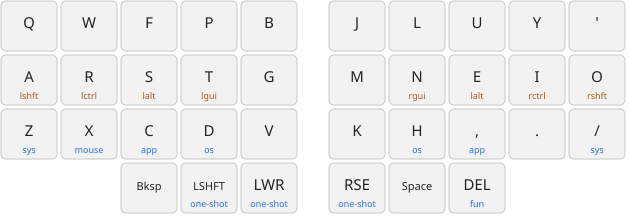
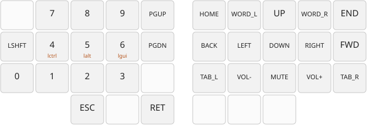
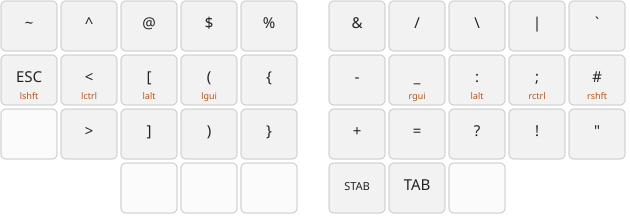
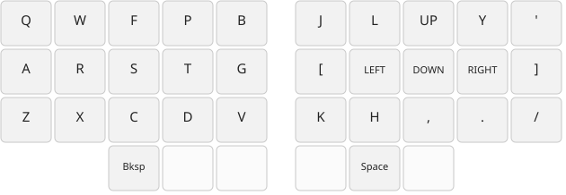
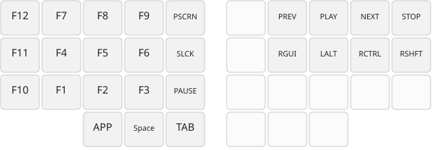
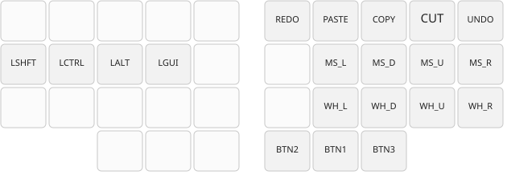
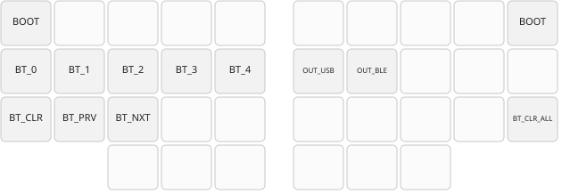
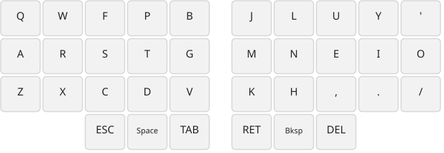

# Kagu

A wireless 36-key split keyboard (3x5+3) on the Seeed XIAO nRF52840, running ZMK.

- `keymap.txt`: the keymap, the only file to edit for layout changes
- `keymap/`: the generator that turns it into ZMK and the diagrams below
- `config/`: ZMK shields and the generated `kagu.keymap`
- `pcb/`: KiCad projects for both halves
- `case/`: OpenSCAD trays, top plates and Choc v2 keycap risers

## Layout

Colemak-DH, after [dubu36](https://github.com/denniskempin/dubu36). Shortcut modifiers sit on the
home row (pinky to index: Shift, Ctrl, Alt, Super, mirrored). Shift and the layers you use while
writing sit on the thumbs, which keeps hold-tap timing out of the way. Blue labels are layers held
from that key, orange ones are modifiers.

### base



W+F types Esc and U+Y types Enter. F+U switches to `extra`, and P+L comes back.

### rse (numbers and navigation)



### lwr (symbols)



### app (Ctrl held) and os (Super held)

Held from C and `,` (app) or D and H (os). The modifier stays down for the whole hold, so every
key is sent with it, including the arrows on U N E I. The os layer is the same grid with Super
held, for niri.



### fun (F-keys and media)

Held from Del. For Ctrl+Alt+F1 (TTY switching), hold Del, I and E, then tap the F-key.



### mouse



### sys (Bluetooth, output, bootloader)

Held from Z or `/`. Each half's bootloader key resets that half.



### extra

Has no mods or layer-taps, for games and other people's hands.



## Editing the keymap

Each layer is a grid of the 36 keys, laid out as they sit on the board: three rows of ten, then
the six thumbs.

```
layer base: left_mods, right_mods
  Q      W        F      P     B          J        L     U      Y     '
  A      R        S      T     G          M        N     E      I     O
  Z/sys  X/mouse  C/app  D/os  V          K        H/os  ,/app  .     \//sys
                  BSPC   LSHFT/LSHFT  lwr/lwr     rse/rse  SPC   DEL/fun
```

```
  Z/sys         tap Z, hold the sys layer
  T/LGUI:hm     tap T, hold Super, as a positional home-row mod
  LSHFT/LSHFT   one-shot Shift on tap, plain Shift on hold
  _ / TRNS      nothing / fall through to the layer below
```

Holds shared by several layers are written once as an `overlay` and listed after the layer name.
`layer app + LCTRL` holds Ctrl for as long as the layer is held. Combos are written
`W F -> ESC`. The header of `keymap.txt` covers the details.

After editing, run `just keymap`. CI fails if `kagu.keymap` or the diagrams are out of date.

## Keycaps

- [3dkeycap.com](https://3dkeycap.com)
